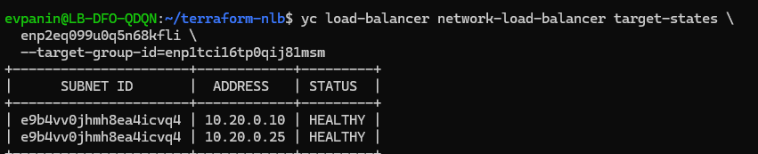
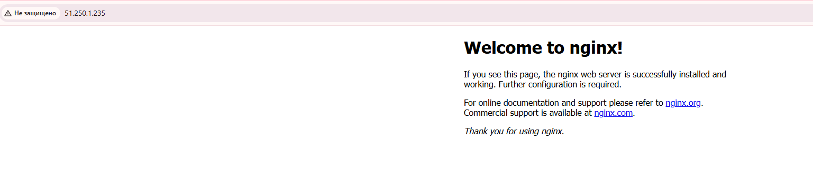

# Домашнее задание к занятию «Отказоустойчивость в облаке»

## Панин Евгений Викторович

## Цель задания

В результате выполнения этого задания вы научитесь:

- Конфигурировать отказоустойчивый кластер в облаке с использованием различных функций отказоустойчивости.
- Устанавливать сервисы из конфигурации инфраструктуры.

## Чеклист готовности к домашнему заданию

- Создан аккаунт на Yandex Cloud.
- Создан новый OAuth-токен.
- Установлено программное обеспечение Terraform.

## Инструкция по выполнению домашнего задания

1. Сделайте fork [репозитория с шаблоном решения](https://github.com/netology-code/sys-pattern-homework) к себе в GitHub и переименуйте его по названию или номеру занятия, например:
   - `https://github.com/имя-вашего-репозитория/gitlab-hw`;
   - `https://github.com/имя-вашего-репозитория/8-03-hw`.
2. Выполните клонирование данного репозитория к себе на ПК с помощью команды `git clone`.
3. Выполните домашнее задание и заполните у себя локально файл `README.md`:
   - впишите вверху название занятия и вашу фамилию и имя;
   - в каждом задании добавьте решение в требуемом виде: текст, код, скриншоты или ссылки;
   - для корректного добавления скриншотов воспользуйтесь инструкцией [«Как вставить скриншот в шаблон с решением»](https://github.com/netology-code/sys-pattern-homework/blob/main/screen-instruction.md);
   - при оформлении используйте возможности языка разметки Markdown: [инструкция по Markdown](https://github.com/netology-code/sys-pattern-homework/blob/main/md-instruction.md).
4. После завершения работы над домашним заданием сделайте коммит (`git commit -m "comment"`) и отправьте его на GitHub (`git push origin`).
5. Для проверки домашнего задания преподавателем в личном кабинете прикрепите и отправьте ссылку на решение в виде Markdown-файла в вашем GitHub.
6. Любые вопросы по выполнению заданий спрашивайте в разделе «Вопросы по заданию» в личном кабинете.

## Инструменты и дополнительные материалы

- [Документация сетевого балансировщика нагрузки](https://cloud.yandex.ru/docs/network-load-balancer/quickstart).

---

## Задание 1

Возьмите за основу [решение к заданию 1 из занятия «Подъём инфраструктуры в Яндекс Облаке»](https://github.com/netology-code/sdvps-homeworks/blob/main/7-03.md#задание-1).

Теперь вместо одной виртуальной машины сделайте Terraform playbook, который:

1. Создаст 2 идентичные виртуальные машины. Используйте аргумент [count](https://www.terraform.io/docs/language/meta-arguments/count.html) для создания таких ресурсов.
2. Создаст [таргет-группу](https://registry.terraform.io/providers/yandex-cloud/yandex/latest/docs/resources/lb_target_group). Поместите в неё созданные на шаге 1 виртуальные машины.
3. Создаст [сетевой балансировщик нагрузки](https://registry.terraform.io/providers/yandex-cloud/yandex/latest/docs/resources/lb_network_load_balancer), который слушает на порту 80, отправляет трафик на порт 80 виртуальных машин и выполняет HTTP healthcheck на порту 80 виртуальных машин.

Рекомендуем изучить [документацию сетевого балансировщика нагрузки](https://cloud.yandex.ru/docs/network-load-balancer/quickstart), чтобы было понятно, что вы сделали.

Установите на созданные виртуальные машины пакет Nginx любым удобным способом и запустите Nginx веб-сервер на порту 80.

Перейдите в веб-консоль Yandex Cloud и убедитесь, что:

- созданный балансировщик находится в статусе `Active`;
- обе виртуальные машины в целевой группе находятся в состоянии `healthy`.

Сделайте запрос на порт 80 внешнего IP-адреса балансировщика и убедитесь, что получаете ответ в виде стандартной страницы Nginx.

В качестве результата пришлите:

1. Terraform Playbook.
2. Скриншот статуса балансировщика и целевой группы.
3. Скриншот страницы, которая открылась при запросе IP-адреса балансировщика.

## Задания со звёздочкой*

Эти задания дополнительные. Выполнять их не обязательно. На зачёт это не повлияет. Вы можете их выполнить, если хотите глубже разобраться в материале.

### Задание 2*

Теперь вместо создания виртуальных машин создайте [группу виртуальных машин с балансировщиком нагрузки](https://cloud.yandex.ru/docs/compute/operations/instance-groups/create-with-balancer).

Nginx нужно поставить автоматизированно. Для этого необходимо подложить файл установки Nginx в ключ `user-data` [метаданных](https://cloud.yandex.ru/docs/compute/concepts/vm-metadata) виртуальной машины.

- [Пример файла установки Nginx](https://github.com/nar3k/yc-public-tasks/blob/master/terraform/metadata.yaml).
- [Как подставлять файл в метаданные виртуальной машины](https://github.com/nar3k/yc-public-tasks/blob/a6c50a5e1d82f27e6d7f3897972adb872299f14a/terraform/main.tf#L38).

Перейдите в веб-консоль Yandex Cloud и убедитесь, что:

- созданный балансировщик находится в статусе `Active`;
- обе виртуальные машины в целевой группе находятся в состоянии `healthy`.

Сделайте запрос на порт 80 внешнего IP-адреса балансировщика и убедитесь, что получаете ответ в виде стандартной страницы Nginx.

В качестве результата пришлите:

1. Terraform Playbook.
2. Скриншот статуса балансировщика и целевой группы.
3. Скриншот страницы, которая открылась при запросе IP-адреса балансировщика.

---

# Выполнение домашнего задания

## Задание 1

### 1. Создание инфраструктуры с помощью Terraform

В Yandex Cloud с помощью Terraform создана следующая инфраструктура:

- облачная сеть `hw-nlb-network`;
- подсеть `hw-nlb-subnet` с диапазоном адресов `10.20.0.0/24`;
- группа безопасности `hw-nlb-web-sg`;
- виртуальные машины `hw-nlb-web-a` и `hw-nlb-web-b`;
- целевая группа `hw-nlb-target-group`;
- внешний сетевой балансировщик `hw-nlb-balancer`.

Для создания двух виртуальных машин использован метааргумент `count = 2`.

Фрагмент конфигурации:

```hcl
locals {
  web_names = ["web-a", "web-b"]
}

resource "yandex_compute_instance" "web" {
  count = 2

  name        = "hw-nlb-${local.web_names[count.index]}"
  hostname    = local.web_names[count.index]
  zone        = "ru-central1-a"
  platform_id = "standard-v3"

  # Полное описание ресурса находится в main.tf.
}
```

Обе ВМ имеют одинаковые параметры и отличаются именами, hostname и IP-адресами.

### 2. Файлы Terraform-конфигурации

Полная конфигурация размещена в файлах:

| Файл | Назначение |
|---|---|
| [providers.tf](providers.tf) | Настройки Terraform и провайдера Yandex Cloud |
| [main.tf](main.tf) | Сеть, подсеть, группа безопасности, ВМ, целевая группа и балансировщик |
| [outputs.tf](outputs.tf) | Вывод IP-адресов |
| [cloud-init.yaml](cloud-init.yaml) | Создание пользователя и установка Nginx |
| [terraform.tfvars.example](terraform.tfvars.example) | Пример переменной для ограничения SSH-доступа |
| [.terraform.lock.hcl](.terraform.lock.hcl) | Зафиксированная версия провайдера |
| [.gitignore](.gitignore) | Исключения для локальных файлов и состояния Terraform |

### 3. Параметры виртуальных машин

| Параметр | Значение |
|---|---|
| Зона доступности | `ru-central1-a` |
| Операционная система | Ubuntu 22.04 LTS |
| Платформа | `standard-v3` |
| Количество vCPU | 2 |
| Гарантированная доля vCPU | 20% |
| Оперативная память | 2 ГБ |
| Загрузочный диск | HDD, 10 ГБ |

Адреса созданных ресурсов:

| Ресурс | Внутренний IP | Внешний IP |
|---|---|---|
| `hw-nlb-web-a` | `10.20.0.10` | `46.21.244.97` |
| `hw-nlb-web-b` | `10.20.0.25` | `51.250.12.153` |
| `hw-nlb-balancer` | — | `51.250.1.235` |

### 4. Порядок развёртывания

Использованы:

- Terraform `1.9.5`;
- провайдер `yandex-cloud/yandex` версии `0.244.0`;
- Yandex Cloud CLI `1.44.0`.

Для повторного запуска необходимо:

1. Установить Terraform и Yandex Cloud CLI.
2. Настроить аутентификацию в Yandex Cloud CLI.
3. Указать собственные `cloud_id` и `folder_id` в `providers.tf`.
4. Подготовить пару SSH-ключей `~/.ssh/id_ed25519` и `~/.ssh/id_ed25519.pub`.
5. Создать `terraform.tfvars` по образцу `terraform.tfvars.example`, указав свой внешний IPv4-адрес с маской `/32`.

Передача IAM-токена в переменную окружения:

```bash
export YC_TOKEN="$(yc iam create-token)"
```

Проверка и применение конфигурации:

```bash
terraform init
terraform fmt
terraform validate
terraform plan
terraform apply
```

Результат проверки конфигурации:

```text
Success! The configuration is valid.
```

План:

```text
Plan: 7 to add, 0 to change, 0 to destroy.
```

Результат развёртывания:

```text
Apply complete! Resources: 7 added, 0 changed, 0 destroyed.
```

Выходные значения:

```text
load_balancer_ip = "51.250.1.235"
web_servers = {
  "hw-nlb-web-a" = {
    "external_ip" = "46.21.244.97"
    "internal_ip" = "10.20.0.10"
  }
  "hw-nlb-web-b" = {
    "external_ip" = "51.250.12.153"
    "internal_ip" = "10.20.0.25"
  }
}
```

### 5. Установка и запуск Nginx

На обеих виртуальных машинах Nginx установлен автоматически через cloud-init.

Файл `cloud-init.yaml` передаётся в метаданные ВМ через ключ `user-data`:

```hcl
metadata = {
  user-data = templatefile("${path.module}/cloud-init.yaml", {
    ssh_public_key = trimspace(file(pathexpand("~/.ssh/id_ed25519.pub")))
  })
}
```

Установка пакета и запуск службы:

```yaml
package_update: true

packages:
  - nginx

runcmd:
  - [systemctl, enable, --now, nginx]
```

Nginx запущен и добавлен в автозагрузку. Стандартная страница веб-сервера не изменялась.

### 6. Создание целевой группы

В целевую группу добавлены внутренние IP обеих ВМ.

```hcl
resource "yandex_lb_target_group" "web" {
  name      = "hw-nlb-target-group"
  region_id = "ru-central1"

  dynamic "target" {
    for_each = yandex_compute_instance.web

    content {
      subnet_id = yandex_vpc_subnet.main.id
      address   = target.value.network_interface.ip_address
    }
  }
}
```

### 7. Настройка сетевого балансировщика

| Параметр | Значение |
|---|---|
| Имя | `hw-nlb-balancer` |
| Тип | Внешний сетевой балансировщик |
| Внешний IP | `51.250.1.235` |
| Протокол обработчика | TCP |
| Входящий порт | 80 |
| Целевой порт | 80 |
| Протокол проверки | HTTP |
| Порт проверки | 80 |
| Путь проверки | `/` |
| Интервал проверки | 5 секунд |
| Тайм-аут проверки | 2 секунды |
| Порог успешных проверок | 2 |
| Порог неуспешных проверок | 2 |

HTTP-трафик поступает на порт 80 внешнего IP балансировщика и направляется на порт 80 виртуальных машин.

### 8. Проверка состояния балансировщика и целевой группы

В веб-консоли Yandex Cloud проверено:

- балансировщик `hw-nlb-balancer` находится в состоянии `Active`;
- ВМ `hw-nlb-web-a` находится в состоянии `Healthy`;
- ВМ `hw-nlb-web-b` находится в состоянии `Healthy`.

Дополнительно выполнена проверка через CLI:

```bash
yc load-balancer network-load-balancer target-states \
  enp2eq099u0q5n68kfli \
  --target-group-id=enp1tci16tp0qij81msm
```

Результат:

```text
+----------------------+------------+---------+
|      SUBNET ID       |  ADDRESS   | STATUS  |
+----------------------+------------+---------+
| e9b4vv0jhmh8ea4icvq4 | 10.20.0.10 | HEALTHY |
| e9b4vv0jhmh8ea4icvq4 | 10.20.0.25 | HEALTHY |
+----------------------+------------+---------+
```

Скриншот проверки состояния:



### 9. Проверка HTTP-доступа

Выполнен запрос к порту 80 внешнего IP балансировщика:

```bash
curl -I --connect-timeout 10 --max-time 15 http://51.250.1.235
```

Получен ответ:

```text
HTTP/1.1 200 OK
Server: nginx/1.18.0 (Ubuntu)
Date: Sun, 08 Nov 2026 16:21:26 GMT
Content-Type: text/html
Content-Length: 612
Last-Modified: Sun, 08 Nov 2026 16:21:13 GMT
Connection: keep-alive
ETag: "6af0a179-264"
Accept-Ranges: bytes
```

При открытии `http://51.250.1.235` в браузере отображается стандартная страница `Welcome to nginx!`.



### Результат задания 1

Выполнены все требования обязательного задания:

1. Созданы две одинаковые по вычислительным параметрам ВМ с использованием `count`.
2. Обе ВМ добавлены в целевую группу.
3. Создан внешний сетевой балансировщик с портами `80 → 80`.
4. Настроена HTTP-проверка на порту 80.
5. На обеих ВМ автоматически установлен Nginx.
6. Балансировщик находится в состоянии `Active`, обе цели — `Healthy`.
7. По внешнему IP балансировщика открывается стандартная страница Nginx.

